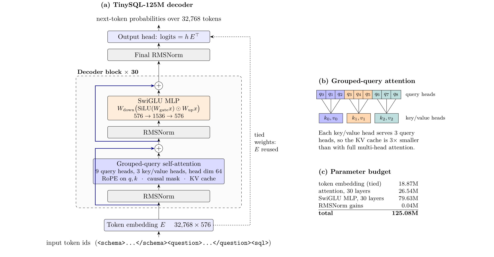
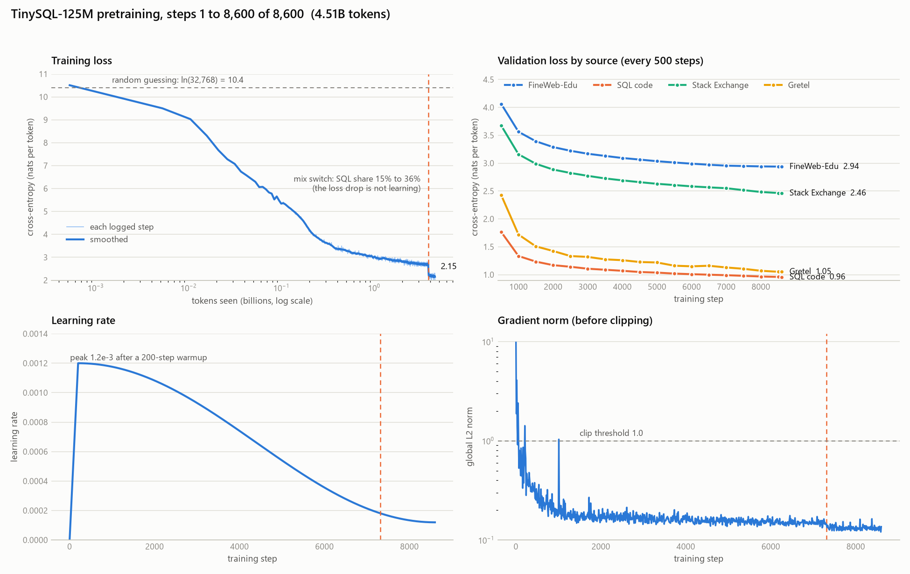

# TinySQL-125M-base

The pretrained base model of TinySQL: a 125M-parameter decoder trained from random initialisation on 4.51B tokens of educational web text and SQL code. Everything was written from scratch: the tokenizer, the transformer, AdamW, the training loop and the data pipeline. It is a plain language model, not instruction-tuned. For text-to-SQL, use [HF_USER/TinySQL-125M-WikiSQL](https://huggingface.co/HF_USER/TinySQL-125M-WikiSQL), or fine-tune this model on your own task.

- **Paper:** [TinySQL: A 125M-Parameter Text-to-SQL Model Built and Pretrained From Scratch on 4.5B Tokens](https://doi.org/10.5281/zenodo.23396770) (Zenodo, 2026)
- **Code:** [github.com/aditya0929/tinysql](https://github.com/aditya0929/tinysql)
- **feel free to contact me at** - https://www.linkedin.com/in/aditya-narayan-jha-36193a251/

## Quick start

```python
from transformers import AutoModelForCausalLM, AutoTokenizer

repo = "HF_USER/TinySQL-125M-base"
tok = AutoTokenizer.from_pretrained(repo)
model = AutoModelForCausalLM.from_pretrained(repo)

prompt = (
    "<schema>CREATE TABLE orders (id INT, customer TEXT, amount REAL, created DATE);</schema>\n"
    "<question>What is the total order amount for each customer?</question>\n"
    "<sql>"
)
ids = tok(prompt, return_tensors="pt").input_ids
out = model.generate(ids, max_new_tokens=60, do_sample=False,
                     eos_token_id=tok.convert_tokens_to_ids("</sql>"))
print(tok.decode(out[0, ids.shape[1]:], skip_special_tokens=True))
# SELECT customer, SUM(amount) FROM orders GROUP BY customer;
```

The pretraining data included synthetic text-to-SQL examples in this `<schema>`/`<question>`/`<sql>` layout, so the base model already writes simple SQL. It was not tuned for accuracy, though, and it often adds conditions nobody asked for: for "How many employees are there?" it writes `SELECT COUNT(*) FROM employees WHERE salary > 50000;`.

## Training

| | |
|---|---|
| Architecture | Llama-style decoder: 30 layers, hidden size 576, 9 query / 3 key-value heads (GQA), SwiGLU 1536, RoPE (theta 10,000), RMSNorm, tied embeddings, context 2048 |
| Parameters | 125,077,824 |
| Tokenizer | own byte-level BPE, 32,768 tokens, including special tokens `<schema>`, `<question>`, `<sql>` and their closing tags |
| Data | 5.41B-token shards: FineWeb-Edu 71%, The Stack SQL subset 26.3% (quality-selected), Stack Exchange dba/datascience 2.2%, Gretel synthetic text-to-SQL 0.5%; cleaned, deduplicated (exact and MinHash-LSH) and decontaminated against WikiSQL dev/test |
| Mix | 82/15/2.5/0.5% (web/SQL/Q&A/synthetic) for the first 85% of steps, then 54/36/8/2% |
| Optimisation | own AdamW (0.9, 0.95), weight decay 0.1, peak LR 1.2e-3, 200 warmup steps, cosine to 1.2e-4, 524,288 tokens per step, bf16 |
| Compute | 8,600 steps, about 46 hours on one NVIDIA L4 (27k tokens/s) |

Final validation loss, in nats per token: FineWeb-Edu 2.94, SQL code 0.96, Stack Exchange 2.46, Gretel 1.05.





The architecture matches Llama, so the weights are distributed in the standard `LlamaForCausalLM` format. The model was trained with the repository's own code. The export is checked to produce the same token ids and logits as the original implementation.

## Full training state

The [`original/`](https://huggingface.co/HF_USER/TinySQL-125M-base/tree/main/original) folder holds the last two pretraining checkpoints in the repository's own format, for resuming or continuing pretraining with its code:

| File | Size | Contents |
|---|---|---|
| `tinysql_125m_pretrain_step8600_full.pt` | 1.40 GB | step 8,600 (the released model): weights, AdamW moments, loss scaler, data-loader and torch random states |
| `tinysql_125m_pretrain_step8500_full.pt` | 1.40 GB | the same at step 8,500; resuming from it reruns the last 100 steps |

Both load with `torch.load(path, weights_only=True)`. To resume, copy one to `runs/main/ckpt_<step>.pt` and run `python -m train.pretrain --config configs/tinysql_125m.yaml`; the trainer picks up the latest checkpoint and needs the token shards from the data pipeline. The [GitHub release](https://github.com/aditya0929/tinysql/releases/tag/v1.0) has the same files plus weights-only checkpoints with SHA-256 checksums.

## Limitations

A small base model trained on 4.5B tokens: its general knowledge and long-form coherence are limited, and it can produce false or nonsensical text. It is mainly useful as a starting point for fine-tuning on SQL or code tasks. It is English only.

## Training data licenses

FineWeb-Edu (ODC-By 1.0), The Stack (dedup), SQL subset (permissively licensed source files, subject to The Stack's terms of use), Stack Exchange dba and datascience (CC BY-SA; 2.5, 3.0 or 4.0 depending on the post date), gretelai/synthetic_text_to_sql (Apache-2.0).

## Citation

```bibtex
@techreport{jha2026tinysql,
  title       = {{TinySQL}: A 125M-Parameter Text-to-SQL Model Built and Pretrained From Scratch on 4.5B Tokens},
  author      = {Jha, Aditya Narayan},
  year        = {2026},
  institution = {Zenodo},
  doi         = {10.5281/zenodo.23396770},
  url         = {https://doi.org/10.5281/zenodo.23396770}
}
```
